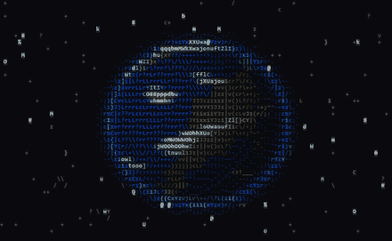
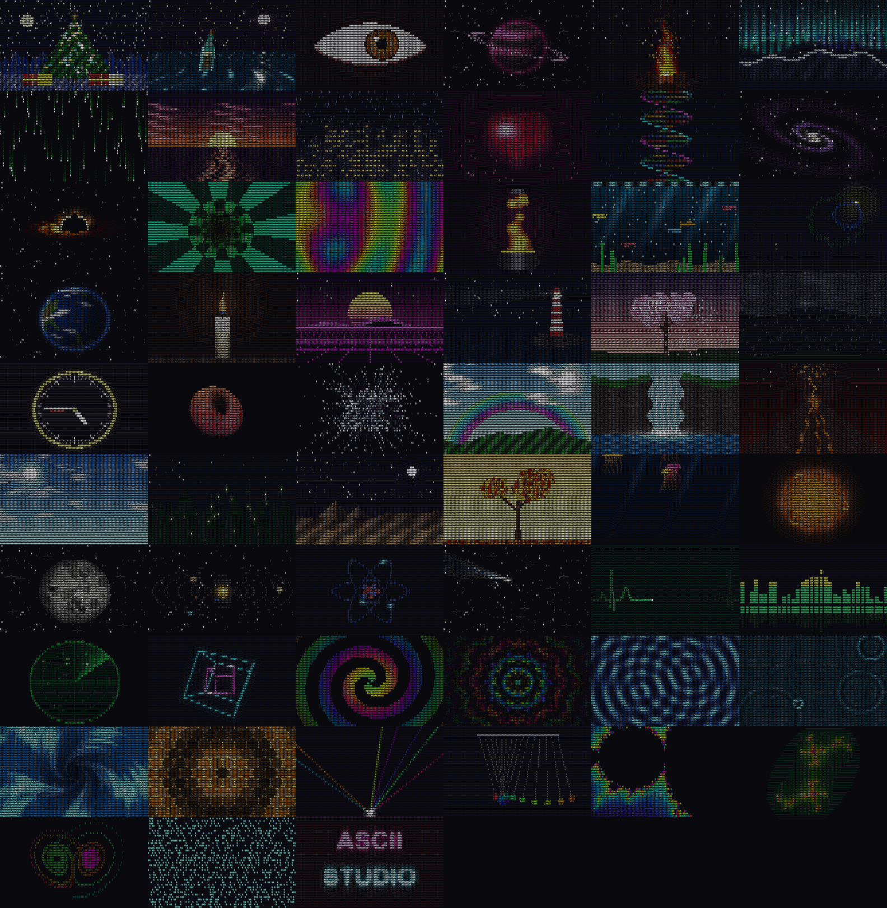
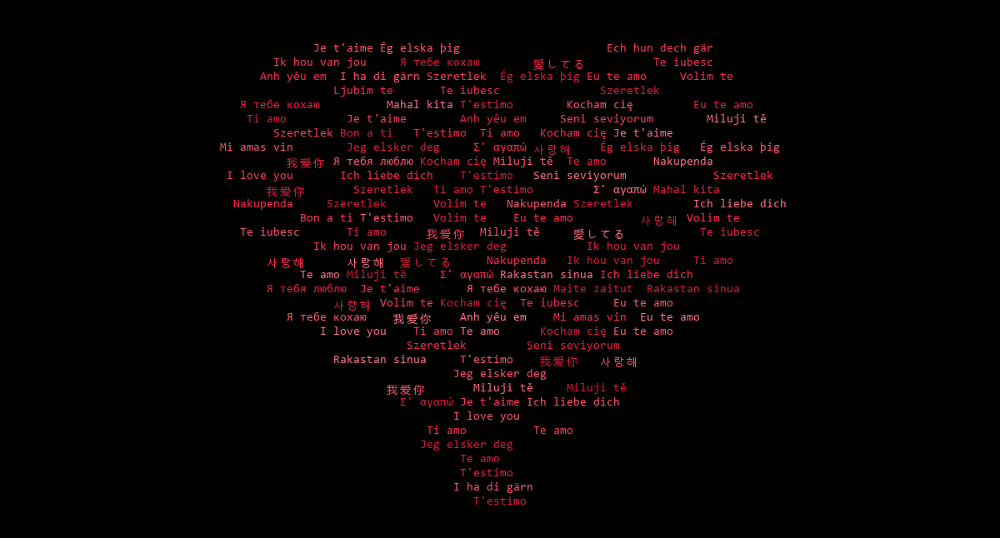

# ASCII Models


**58 colourful ASCII animations that run right in your terminal.** Every animation is a single, self-contained
Python file. Open the folder in VS Code, click a file, press **Ctrl + Alt + N**, and watch it play.

<p align="center">
  
</p>

No app, no setup wizard, no assets: every frame is computed from maths (sine waves, particles, fractals, 3D
projection) and drawn with plain text characters in 24-bit colour.

---

## Contents

- [Quick start](#quick-start)
- [Controls](#controls)
- [All models](#all-models)
- [How it works](#how-it-works)
- [Write your own model](#write-your-own-model)
- [Troubleshooting](#troubleshooting)
- [License](#license)

---

## Quick start

**You need**

- [Python 3.8+](https://www.python.org/downloads/) with NumPy: `pip install numpy`
- [VS Code](https://code.visualstudio.com/) with the [Code Runner](https://marketplace.visualstudio.com/items?itemName=formulahendry.code-runner) extension (for **Ctrl + Alt + N**)

**Run**

1. Clone or download this repository and open the folder in VS Code (**File → Open Folder**).
2. VS Code asks whether you trust the folder. Click **Trust**. (In *Restricted Mode* VS Code blocks all code from running.)
3. Click a model, for example `19_earth.py`.
4. Press **Ctrl + Alt + N**. The animation fills the terminal at the bottom.

The included `.vscode/settings.json` already tells Code Runner to run inside the terminal, so nothing else needs
to be configured.

**Without VS Code** it works in any modern terminal with true-colour support (Windows Terminal, iTerm2, most Linux terminals):

```bash
pip install numpy
python 19_earth.py
```

> Tip: a bigger terminal, or a smaller font (**Ctrl + mouse wheel** in the VS Code terminal), shows more detail.
> The animation adapts to the terminal size live.

---

## Controls

| Action | How |
|---|---|
| Start a model | Open the file, press **Ctrl + Alt + N** (or `python file.py`) |
| Switch to another model | While one is running, open another file and press **Ctrl + Alt + N** again. The running one hands over directly. |
| Stop | **Ctrl + C** or **Esc** in the terminal |

---

## All models

<p align="center"></p>

| # | Model | # | Model |
|---|---|---|---|
| 1 | [🎄 Winter Night](01_winter_night.py) | 30 | [🌋 Volcano](30_volcano.py) |
| 2 | [🍾 Message in a Bottle](02_message_in_a_bottle.py) | 31 | [☁️ Cloudy Sky](31_cloudy_sky.py) |
| 3 | [👁️ Eye](03_eye.py) | 32 | [✨ Fireflies](32_fireflies.py) |
| 4 | [🪐 Planet](04_planet.py) | 33 | [🏜️ Desert Night](33_desert_night.py) |
| 5 | [🔥 Campfire](05_campfire.py) | 34 | [🍂 Autumn Leaves](34_autumn_leaves.py) |
| 6 | [🌌 Northern Lights](06_northern_lights.py) | 35 | [🪼 Jellyfish](35_jellyfish.py) |
| 7 | [💚 Matrix Rain](07_matrix_rain.py) | 36 | [☀️ Sun](36_sun.py) |
| 8 | [🌅 Sunset](08_sunset.py) | 37 | [🌕 Moon](37_moon.py) |
| 9 | [🌃 Rainy City](09_rainy_city.py) | 38 | [🪐 Solar System](38_solar_system.py) |
| 10 | [❤️ Heart](10_heart.py) | 39 | [⚛️ Atom](39_atom.py) |
| 11 | [🧬 DNA](11_dna.py) | 40 | [☄️ Comet](40_comet.py) |
| 12 | [🌀 Galaxy](12_galaxy.py) | 41 | [💓 Heartbeat ECG](41_heartbeat_ecg.py) |
| 13 | [⚫ Black Hole](13_black_hole.py) | 42 | [🎚️ Equalizer](42_equalizer.py) |
| 14 | [🕳️ Tunnel](14_tunnel.py) | 43 | [📡 Radar](43_radar.py) |
| 15 | [🎨 Plasma](15_plasma.py) | 44 | [🧊 Cube 3D](44_cube_3d.py) |
| 16 | [🫧 Lava Lamp](16_lava_lamp.py) | 45 | [🌀 Hypnotic Spiral](45_hypnotic_spiral.py) |
| 17 | [🐠 Underwater](17_underwater.py) | 46 | [🔮 Kaleidoscope](46_kaleidoscope.py) |
| 18 | [🎆 Fireworks](18_fireworks.py) | 47 | [〰️ Wave Interference](47_wave_interference.py) |
| 19 | [🌍 Earth](19_earth.py) | 48 | [💦 Raindrops](48_raindrops.py) |
| 20 | [🕯️ Candle](20_candle.py) | 49 | [🌊 Whirlpool](49_whirlpool.py) |
| 21 | [🌆 Synthwave](21_synthwave.py) | 50 | [🐝 Honeycomb](50_honeycomb.py) |
| 22 | [🗼 Lighthouse](22_lighthouse.py) | 51 | [🔦 Laser Show](51_laser_show.py) |
| 23 | [🌸 Cherry Blossom](23_cherry_blossom.py) | 52 | [⏱️ Pendulum Wave](52_pendulum_wave.py) |
| 24 | [⛈️ Thunderstorm](24_thunderstorm.py) | 53 | [♾️ Mandelbrot Zoom](53_mandelbrot_zoom.py) |
| 25 | [🕰️ Clock (real time)](25_clock.py) | 54 | [❄️ Julia Fractal](54_julia_fractal.py) |
| 26 | [🍩 Donut 3D](26_donut_3d.py) | 55 | [🦋 Lorenz Attractor](55_lorenz_attractor.py) |
| 27 | [🚀 Starfield](27_starfield.py) | 56 | [🧫 Game of Life](56_game_of_life.py) |
| 28 | [🌈 Rainbow](28_rainbow.py) | 57 | [💡 Neon Sign](57_neon_sign.py) |
| 29 | [💧 Waterfall](29_waterfall.py) | 💌 | [Love Heart](love_heart.py) |

### 💌 Love Heart

`love_heart.py` is a bit different: instead of shading pixels it places **"I love you" in 34 languages**
(English, German, Swiss German, Korean, Japanese, Chinese, Greek, Russian, …) into the shape of a heart.
First the words trace the outline from the tip upwards, then they fill the inside without overlapping, and
finally the heart beats and single words sparkle. It uses only the Python standard library.

<p align="center"></p>

---

## How it works

Every file has the same three parts:

```
┌──────────────────────────────┐
│ 1. The model                 │  def earth(t, u, v, a, cols, rows) -> image
│    maths for one frame       │     t = time in seconds
│                              │     u, v = position of every character (0..1)
│                              │     a = aspect ratio (width / height)
├──────────────────────────────┤
│ 2. Helpers                   │  only the helpers this model needs
│    (noise, stars, lines …)   │  plus fixed random values (seeded)
├──────────────────────────────┤
│ 3. The player                │  terminal size → frame → characters + colours
│                              │  → writes ANSI escape codes, ~30 fps
└──────────────────────────────┘
```

1. **Model → colour image.** The model function returns an image with one RGB pixel per terminal character
   (`rows × cols × 3`, values 0..1), computed with NumPy for the whole grid at once.
2. **Brightness → character.** Each pixel picks a character from a ramp sorted by "ink"
   (dark pixels become a space or a dot, bright ones a `@` or `$`):
   ```
    .'`^",:;Il!i><~+_-?][}{1)(|\/tfjrxnuvczXYUJCLQ0OZmwqpdbkhao*#MW&8%B@$
   ```
3. **Colour → ANSI.** The character is printed in the pixel's colour with 24-bit escape codes
   (`ESC[38;2;R;G;Bm`). A new code is only written when the colour changes.
4. **Robust output.** Each row is positioned explicitly, the frame is written in chunks, and the real terminal
   size is read every frame, so resizing the terminal works while the animation runs.

---

## Write your own model

Copy any file, rename it, and replace the model function. A minimal example:

```python
def pulsing_circle(t, u, v, a, cols, rows):
    """A circle that breathes."""
    img = np.zeros(u.shape + (3,), np.float32)        # black image, rows x cols x RGB
    x, y = (u - 0.5) * a, v - 0.5                       # centred coordinates, height = 1
    radius = 0.25 + 0.05 * np.sin(t * 3)                # radius changes over time
    img[x * x + y * y < radius ** 2] = (0.2, 0.8, 1.0)  # fill the circle light blue
    return img
```

At the bottom of the file, start your function: `play(pulsing_circle)`.

---

## Troubleshooting

| Problem | Fix |
|---|---|
| **Ctrl + Alt + N does nothing**, no "Run Code" in the right-click menu | The folder is in **Restricted Mode**. Click the *Restricted Mode* banner (or **Ctrl + Shift + P → "Manage Workspace Trust"**) and choose **Trust**. Also check that the *Code Runner* extension is installed. |
| The terminal only shows strange control characters | Code Runner is running in the *Output* panel instead of the terminal. Open this folder as the workspace so `.vscode/settings.json` applies (`code-runner.runInTerminal: true`). |
| `ModuleNotFoundError: No module named 'numpy'` | `pip install numpy` (for the same Python that VS Code uses). |
| The picture looks squashed or tiny | Make the terminal panel bigger or the font smaller (**Ctrl + mouse wheel**). The animation adapts automatically. |
| Colours look wrong | Use a terminal with true-colour support (VS Code, Windows Terminal, iTerm2). The old `cmd.exe` window can't show 24-bit colour. |

---

## License

[MIT](LICENSE) © 2026 Gian Kappeler

Inspired by ASCII art clips on TikTok. All models are written from scratch.
